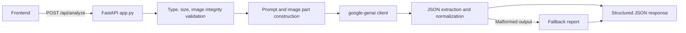
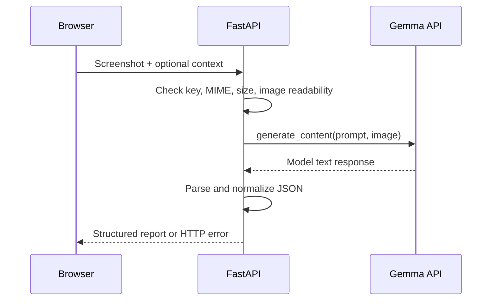

# PixelPilot Architecture

## Current architecture

PixelPilot currently uses a small FastAPI application in `app.py`. The same module owns the API routes, screenshot validation, Google GenAI call, response parsing, fallback report, and static frontend serving. The frontend is served from `frontend/`; no separate service or database exists.

## Repository structure

```text
app.py                 FastAPI app, validation, inference, parsing, static serving
frontend/              Browser UI assets served under `/static/`
tests/test_app.py      Isolated unittest coverage
docs/                  Product and implementation documentation
.env.example           Configuration template without secrets
requirements.txt       Runtime dependencies
```

## Responsibilities and data flow





The `/api/analyze` route checks `GEMINI_API_KEY`, accepts `image/png`, `image/jpeg`, and `image/webp`, reads at most 10 MB plus one byte, verifies both image readability and detected format with Pillow, and enforces a 4000-character limit on each text field. It does not use upload filenames or write uploads to disk, so filenames cannot affect filesystem paths. It then calls `call_gemma_analysis`. That function initializes `google.genai.Client` with a 60-second HTTP timeout, constructs a prompt with the screenshot and optional context, and calls `client.models.generate_content(...)`.

`parse_and_validate_json` strips JSON fences, extracts an object from surrounding commentary when possible, rejects invalid top-level report shapes, applies report defaults, and normalizes issue fields. It is normalization rather than a full schema validator. Malformed model output receives a structured fallback report. Provider failures are mapped to generic structured HTTP errors without exposing raw provider details, credentials, or stack traces. The configured model must equal `gemma-4-26b-a4b-it`; there is no alternate-model fallback.

## Configuration

- `GEMINI_API_KEY`: required secret, loaded from `.env` or the process environment.
- `GEMMA_MODEL`: configurable model identifier; default is `gemma-4-26b-a4b-it`.
- `MAX_IMAGE_SIZE_MB`, `MAX_TEXT_LENGTH`, and allowed MIME types are source constants.

The `.env` file is local-only and must never be logged or committed.

## Testing and diagnostics

`tests/test_app.py` uses `unittest` and directly exercises the parser and async route validation. Its successful PNG test replaces the model function to avoid network access; it does not verify live inference. A genuine model check must be a separately identified, credentialed integration check using the exact configured model. The project `.venv` contains the declared dependencies; live and browser checks are recorded separately from unit tests.

## Trade-offs and limitations

The single-module design is proportionate to a hackathon MVP and keeps the request path easy to follow, but it couples HTTP handling and domain logic. The parser does not enforce enumerated severity or confidence values, and screenshot analysis is static. Uploaded code is context only and is never executed. There is no authentication, persistence, browser automation, or multi-user state.

Future extensions may extract validation, model access, and report schemas into small modules, but such separation should follow demonstrated complexity rather than precede it.